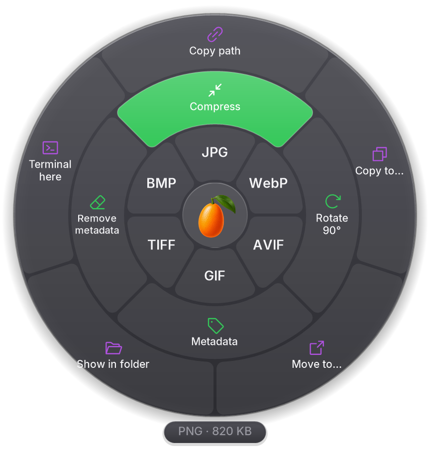

<p align="center"></p>

<h1 align="center">Kumquat</h1>

<p align="center"><a href="README.md">Español</a> · <b>English</b></p>

<p align="center">
  <a href="https://github.com/MartinQuiri/kumquat/actions/workflows/ci.yml"></a>
  <a href="https://github.com/MartinQuiri/kumquat/releases"></a>
  <a href="LICENSE"></a>
  
  
</p>

**Convert files without opening anything.** Drag a file, press **Shift** and drop it on the format you want in the wheel that appears next to the pointer. Everything happens on your PC: nothing is uploaded.

Kumquat is a free (GPL-3.0) Windows alternative inspired by the interaction of [Tangerine for Mac](https://tangerineformac.com). It is not affiliated with Tangerine or Leap Studio.

> **Status: pre-alpha (0.1).** See the [roadmap](#roadmap).

<p align="center"></p>

## Install

1. Download **`Kumquat-<version>-win-x64.msi`** from [Releases](https://github.com/MartinQuiri/kumquat/releases) (or `win-arm64` for ARM PCs).
2. Open it: it installs for your user only, **without admin rights**, and Kumquat opens when it finishes.

Rather not install anything? The `.zip` is portable: unzip it and open `Kumquat.exe`.

> Until releases are signed, Windows SmartScreen may say "Windows protected your PC": **More info → Run anyway**. Every file ships its SHA-256 so you can verify it.

## How to use it

1. Run `Kumquat.exe` (or install the MSI): the kumquat appears in the notification area.
2. Start dragging a file from File Explorer (or any app).
3. Without letting go, tap **Shift**. The wheel appears under the pointer.
4. Drop it on a format. The converted copy appears next to the original (the original is never touched).

**Progress:** when something takes a while (a video, a large PDF, a batch of photos), a small panel appears at the bottom right with each file, its percentage and **how much time is left**, estimated from the actual pace of the work. Each row can be cancelled; "Hide" tucks it away until the next batch. Instant jobs don't make it appear, and it goes away by itself when everything is done.

Dropping on the center (the logo) or pressing **Esc** cancels. The gesture can be changed to Ctrl, Caps Lock or right-click in **Settings** (tray icon menu).

**With the keyboard: the search.** Select one or more files in File Explorer (or on the desktop) and press **Ctrl+Alt+K**, or right-click → **Kumquat…** (on Windows 11 it is in the new menu; on Windows 10, in the classic one). A search box lists everything you can do with those files: type to filter (`pdf`, `compress`, `path`… accents don't matter, Spanish and English words both work), ↑ ↓ to choose, **Enter** to apply and **Esc** to close.

**Accessibility:** everything on the wheel can be done from the keyboard search. With Narrator, NVDA or JAWS, the wheel announces what was dragged, how many options there are and which sector is selected, and the search reads the selected option and its position. In high contrast, the wheel and windows use only the system colors.

**Language:** Spanish or English. By default, the Windows language (English if Windows is in another language); change it in Settings. Want to translate Kumquat? See [CONTRIBUTING.md](CONTRIBUTING.md#textos-e-idiomas).

There is also a CLI:

```powershell
kumquat-cli convert photo.heic --to jpg
kumquat-cli convert *.wav --to mp3 --out D:\music
kumquat-cli targets video.mkv      # formats it can be converted to
```

## The wheel: 3 rings

| Ring | What it does |
|---|---|
| **Inner** (orange) | Convert to another format |
| **Middle** (teal) | Tools |
| **Outer** (purple) | Actions on the file |

### Conversions

| Family | Input | Output |
|---|---|---|
| Images | JPG, PNG, WebP, GIF, HEIC, AVIF, TIFF, BMP, SVG | JPG, PNG, WebP, GIF, AVIF, TIFF, BMP, PDF |
| Audio | MP3, M4A, WAV, FLAC, OGG, Opus, AIFF, WMA | the same |
| Video | MP4, MOV, MKV, WebM, AVI, WMV, GIF | the same + extract audio + GIF |
| PDF / EPUB | PDF, EPUB | TXT; EPUB → PDF; **PDF → Word (DOCX)** |
| Office | DOCX, DOC, ODT, RTF · XLSX, XLS, ODS · PPTX, PPT, ODP | PDF |
| E-books (with Calibre) | EPUB, MOBI, AZW3, FB2, DOCX | EPUB, AZW3 (Kindle), MOBI, PDF |

Multi-step conversions are planned automatically (e.g. HEIC → JPG → PDF), and meaningless targets are never offered (a photo is not converted to MP3).

### Tools

| For | Tools |
|---|---|
| Images | Compress · Rotate 90° · Flip · Max. 1920 px · Black and white · **Metadata** · Remove metadata · Extract text (OCR) · Searchable PDF (OCR) · Combine into PDF |
| PDF | Compress · Rotate 90° · Split pages · Pages to JPG · **Extract pages** · **Protect** · **Unlock** · **Metadata** · Recognize text (OCR) · Merge PDFs |
| Video | Compress · Remove audio · Rotate 90° · Frame · **Trim** · **Metadata** · Merge videos |
| Audio | Normalize · **Trim** · **Metadata** · Merge audio |
| Word, Excel, PowerPoint | **Metadata** |
| Archives | Extract (ZIP, RAR, 7z, TAR, GZIP) |
| Anything, folders included | Create ZIP |

**Password-protected PDFs:** no need to unlock them first. Compress, Rotate, Split, Extract pages and Pages to JPG ask for the password and open the file themselves; the result keeps the same password (images are saved without one). Protect changes it: it asks for the current and the new one. The original is never touched.

Tools in **bold** open an options window with the file's current values already filled in and a **preview** (PDF page thumbnails, a video player with a frame strip to pick the segment, the audio waveform).

**Office documents** are converted with **what you already have installed**: Microsoft Office if present (best fidelity with its own formats), otherwise [LibreOffice](https://www.libreoffice.org). If there is neither, the wheel offers **Install LibreOffice**: it asks first, installs the official package with winget and restarts Kumquat. Office runs hidden, with macros disabled, read-only, on a copy of the file.

**E-books:** EPUB → PDF/TXT always work. For Kindle (MOBI, AZW3), FB2 and Word → EPUB, Kumquat uses [Calibre](https://calibre-ebook.com) if installed (or offers to install it), with a temporary configuration that never touches your library.

**OCR** with [Tesseract](https://github.com/tesseract-ocr/tesseract), in Spanish and English at once: photo → text, photo → searchable PDF, scanned PDF → searchable PDF (only pages without text are recognized).

**Attachments, files inside a .zip and images from a web page** can be dropped on the wheel without saving them first; the result goes to the Desktop (configurable).

**Float: a shelf to carry files around.** Drop files on **Float** and they wait in a floating stack, always visible, while you go to another folder or open the page where you need to upload them. Drag the stack to drop them all at once (into a folder, an email or a web form), or click it to see them one by one and drag just the one you need. You can keep dropping files on it, have several shelves at once and move them by dragging their edge. Nothing is copied or moved when you leave files there; whatever you move elsewhere leaves the shelf, and an empty shelf closes itself.

## Building

Requirements: Windows 10 22H2+ or 11, [.NET SDK 10](https://dotnet.microsoft.com/download) (exact version in `global.json`) and, to build Tesseract the first time, Visual Studio 2022 with "Desktop development with C++" (includes vcpkg).

```powershell
./tools/fetch-engines.ps1          # downloads the engines (SHA-256 verified) and builds Tesseract
dotnet build Kumquat.slnx
dotnet test --solution Kumquat.slnx --filter-not-trait "Category=E2E" --ignore-exit-code 8
dotnet run --project src/Kumquat.App
```

Package and installer: `./tools/publish.ps1 -Runtime win-x64` and `./tools/build-installer.ps1 -Runtime win-x64` (per-user MSI, no admin rights). Releasing: [docs/RELEASING.md](docs/RELEASING.md).

The E2E tests perform a real drag by moving the mouse: run them only when you are not using the PC.

## Quality

- Every compiler and analyzer warning is an error; dangerous APIs are banned at compile time.
- **One integration test per direct conversion**, generated from the capability graph, with outputs checked by content.
- Engines run as separate processes inside a Windows Job Object (bounded memory, they die with Kumquat), at low priority.
- CI on x64 and ARM64, CodeQL, OpenSSF Scorecard, REUSE and Dependabot.

Details (in Spanish): [docs/ARCHITECTURE.md](docs/ARCHITECTURE.md) and [CONTRIBUTING.md](CONTRIBUTING.md).

## Roadmap

- [x] Conversion wheel for images, audio, video, PDF, Office and e-books; tools and actions; options windows with preview.
- [x] Keyboard search (Ctrl+Alt+K) and classic right-click menu.
- [x] OCR, attachments and virtual files, Spanish and English UI, accessibility.
- [x] Per-user MSI installer and winget manifest.
- [x] "Kumquat…" in the Windows 11 modern context menu (enabled by signed releases; in development, with Developer Mode).
- [ ] Code signing (SignPath), winget submission and Microsoft Store.
- [ ] Engine sandboxing (low integrity / AppContainer), continuous fuzzing.

## License

[GPL-3.0-or-later](LICENSE). [Inter](https://rsms.me/inter/) typeface (OFL-1.1) and [Phosphor](https://phosphoricons.com) icons (MIT). Kumquat includes or downloads third-party components under their own licenses: see [THIRD-PARTY-NOTICES.md](THIRD-PARTY-NOTICES.md).

**Patents:** the H.264, HEVC and AAC codecs may be covered by patents in some countries. Kumquat is distributed as free software without patent licenses; check your jurisdiction if you redistribute it commercially.
