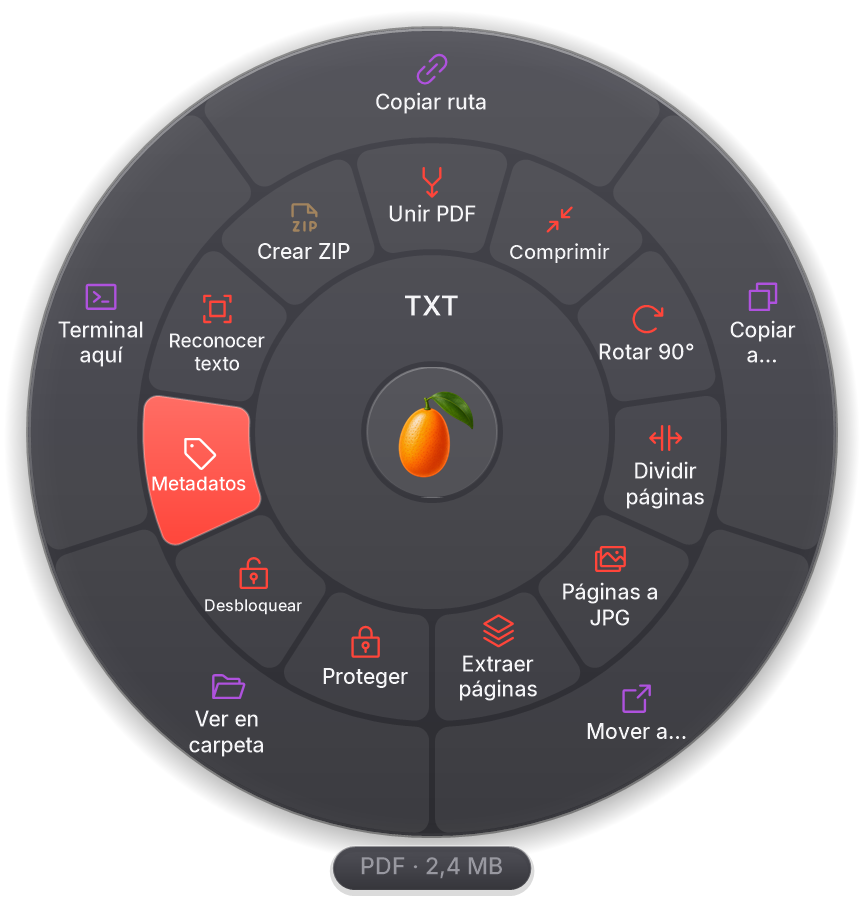
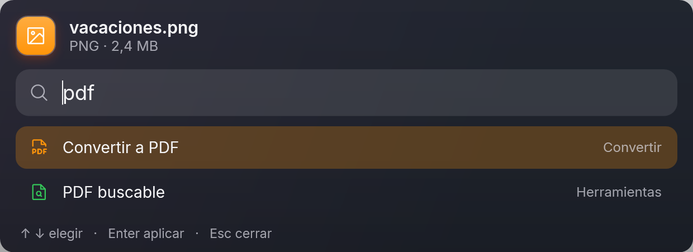
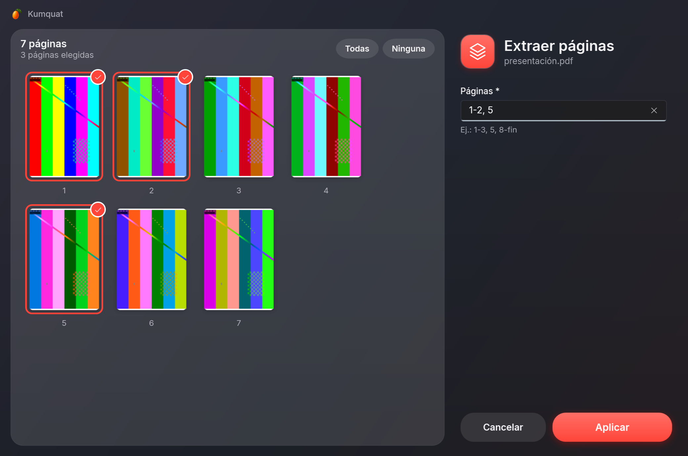
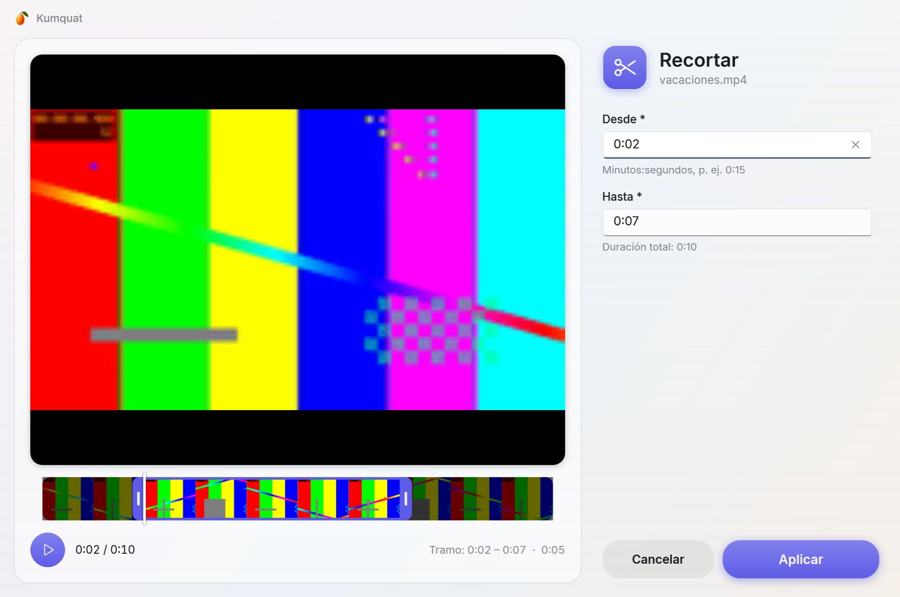

<p align="center"></p>

# Kumquat

**Convierte archivos sin abrir nada.** Arrastra un archivo, presiona **Shift** y suéltalo sobre el formato que quieras en la rueda que aparece junto al cursor. Todo ocurre en tu PC: nada se sube a internet.

Kumquat es una alternativa libre (GPL-3.0) para Windows inspirada en la interacción de [Tangerine para Mac](https://tangerineformac.com). No está afiliado a Tangerine ni a Leap Studio.

> **Estado: pre-alfa (0.1).** Ver [hoja de ruta](#hoja-de-ruta).

<p align="center"></p>

## Cómo se usa

1. Ejecuta `Kumquat.exe`: aparece el kumquat en el área de notificación.
2. Empieza a arrastrar un archivo desde el Explorador (o cualquier app).
3. Sin soltar, toca **Shift**. Aparece la rueda bajo el cursor.
4. Suelta sobre un formato. La copia convertida aparece junto al original (el original nunca se toca).

Soltar en el centro (el logo) o presionar **Esc** cancela. El gesto se puede cambiar a Ctrl, Bloq Mayús o clic derecho en **Configuración** (menú del ícono).

**Con el teclado: el buscador.** Selecciona uno o más archivos en el Explorador (o en el escritorio) y presiona **Ctrl+Alt+K**, o haz clic derecho → **Kumquat…** (en Windows 11, dentro de "Mostrar más opciones"). Aparece un buscador con todo lo que se puede hacer con esos archivos: escribe para filtrar (`pdf`, `comprimir`, `achicar`, `ruta`… sin importar tildes), ↑ ↓ para elegir, **Enter** para aplicar y **Esc** para cerrar. La rueda queda para arrastrar con el mouse.

<p align="center"></p>

La entrada del clic derecho se registra solo para tu usuario, sin permisos de administrador; se quita en Configuración o con `Kumquat.exe --unregister`.

También hay una CLI:

```powershell
kumquat-cli convert foto.heic --to jpg
kumquat-cli convert *.wav --to mp3 --out D:\musica
kumquat-cli targets video.mkv      # a qué formatos se puede convertir
```

## La rueda: 3 anillos

| Anillo | Qué hace |
|---|---|
| **Interior** (naranja) | Convertir a otro formato |
| **Medio** (verde azulado) | Herramientas |
| **Exterior** (violeta) | Acciones sobre el archivo |

Cada herramienta tiene su ícono y el color de su familia (PDF rojo, imagen verde, video índigo, audio rosa). Los anillos vacíos no se muestran.

### Conversiones

| Familia | Entrada | Salida |
|---|---|---|
| Imágenes | JPG, PNG, WebP, GIF, HEIC, AVIF, TIFF, BMP, SVG | JPG, PNG, WebP, GIF, AVIF, TIFF, BMP, PDF |
| Audio | MP3, M4A, WAV, FLAC, OGG, Opus, AIFF, WMA | las mismas |
| Video | MP4, MOV, MKV, WebM, AVI, WMV, GIF | las mismas + extraer audio + GIF |
| PDF / EPUB | PDF, EPUB | TXT; EPUB → PDF |

Las conversiones de varios pasos se planifican solas (p. ej. HEIC → JPG → PDF), y nunca se ofrecen destinos sin sentido (una foto no se convierte a MP3).

### Herramientas

| Para | Herramientas |
|---|---|
| Imágenes | Comprimir · Rotar 90° · Voltear · Máx. 1920 px · Blanco y negro · **Metadatos** · Sin metadatos · Extraer texto (OCR) · PDF buscable (OCR) · Unir en PDF (varias) |
| PDF | Comprimir · Rotar 90° · Dividir páginas · Páginas a JPG · **Extraer páginas** · **Proteger** · **Desbloquear** · **Metadatos** · Reconocer texto (OCR) · Unir PDF (varios) |
| Video | Comprimir · Quitar audio · Rotar 90° · Fotograma · **Recortar** · **Metadatos** · Unir videos (varios) |
| Audio | Normalizar · **Recortar** · **Metadatos** · Unir audios (varios) |
| Word, Excel, PowerPoint | **Metadatos** |
| Comprimidos | Extraer (ZIP, RAR, 7z, TAR, GZIP) |
| Todo, incluidas carpetas | Crear ZIP |

Las herramientas en **negrita** abren una ventana de opciones (vidrio acrílico de Windows 11) con los valores actuales del archivo ya cargados y **vista previa**:

- **PDF:** miniaturas de las páginas; en *Extraer páginas* se eligen con un clic (sincronizado con el campo de texto).
- **Video:** reproductor y tira de fotogramas con asas para elegir el tramo a recortar; al mover un asa se ve ese fotograma.
- **Audio:** forma de onda con el tramo elegido y reproducción.
- **Fotos:** la imagen.

<p align="center"></p>
<p align="center"></p>

**Metadatos:** autor, título, asunto, palabras clave, etc., con campos personalizados en PDF, audio y video. Al editar varios archivos a la vez solo se cambian los campos que modificas. En fotos el autor se escribe en XMP y en los campos de Windows (Unicode: "María Pérez" se ve bien en el Explorador), y en JPEG la imagen no se recomprime: los píxeles quedan idénticos.

Al unir, el orden es el natural de los nombres (`foto2` antes que `foto10`). El resultado aparece junto al original (`foto (comprimido).jpg`); nunca se sobrescribe nada.

### Reconocer texto (OCR)

Con [Tesseract](https://github.com/tesseract-ocr/tesseract), en español e inglés a la vez y sin salir de tu PC:

- **Extraer texto:** una foto o captura → `.txt`.
- **PDF buscable:** una foto → PDF con la imagen y el texto encima, invisible: se puede seleccionar, copiar y buscar.
- **Reconocer texto:** un PDF escaneado → PDF buscable. Solo se reconocen las páginas que no tienen texto; las que ya lo tienen quedan exactamente como estaban.

### Adjuntos, archivos de un .zip e imágenes de una web

Se pueden soltar en la rueda **sin guardarlos antes**: un adjunto arrastrado desde Outlook, un archivo de dentro de un .zip abierto en el Explorador o una imagen de una página web. Como no tienen carpeta propia, el resultado va al **Escritorio** (se cambia en Configuración) y la etiqueta bajo la rueda lo avisa. En el anillo de acciones aparece **Guardar en Escritorio** para simplemente guardarlos.

### Acciones

Copiar ruta · Copiar a… · Mover a… · Ver en carpeta · Terminal aquí (y Guardar en… para archivos sin carpeta)

## Compilar

Requisitos: Windows 10 22H2+ o 11, [.NET SDK 10](https://dotnet.microsoft.com/download) (la versión exacta está en `global.json`) y, para compilar Tesseract la primera vez, Visual Studio 2022 con "Desarrollo para el escritorio con C++" (trae vcpkg).

```powershell
./tools/fetch-engines.ps1          # descarga los motores verificando su SHA-256 y compila Tesseract
dotnet build Kumquat.slnx
dotnet test --solution Kumquat.slnx --filter-not-trait "Category=E2E" --ignore-exit-code 8
dotnet run --project src/Kumquat.App
```

Para generar el paquete distribuible (self-contained, recortado, ~93 MB en zip, arranque ~0,3 s):

```powershell
./tools/publish.ps1 -Runtime win-x64     # o win-arm64
```

Los tests E2E hacen un arrastre real moviendo el mouse: córrelos solo cuando no estés usando el PC (`dotnet test --project tests/Kumquat.E2E.Tests`).

## Calidad

- Toda advertencia del compilador y de los analizadores (.NET, Meziantou, reglas propias) es un error.
- APIs peligrosas prohibidas en compilación: lanzar procesos con argumentos concatenados, extraer ZIP sin validar rutas, etc. ([BannedSymbols.txt](BannedSymbols.txt)).
- **Un test de integración por cada conversión directa**, generado desde el grafo de capacidades: si alguien agrega una conversión, queda probada automáticamente. Las salidas se verifican por contenido (bytes mágicos) y con ffprobe (duración, dimensiones, pistas).
- Tests basados en propiedades (CsCheck) para el planificador, la detección de formatos y la geometría de la rueda.
- Los motores corren como procesos aparte dentro de un *Job Object* de Windows (memoria acotada, mueren con Kumquat), con prioridad baja.
- CI en x64 y ARM64, CodeQL, OpenSSF Scorecard, REUSE y Dependabot.

Detalles en [docs/ARCHITECTURE.md](docs/ARCHITECTURE.md) y [CONTRIBUTING.md](CONTRIBUTING.md).

## Hoja de ruta

- [x] Fase 0–1: rueda de conversión, imágenes/audio/video, bandeja, CLI.
- [x] Fase 2a: rueda de 3 anillos, herramientas de PDF, imagen, audio, video y comprimidos; acciones copiar/mover.
- [x] Fase 2b: ventana de opciones (Fluent), recortar audio/video, extraer páginas, proteger/desbloquear PDF, metadatos de fotos, PDF, audio, video y Office.
- [x] Rediseño: rueda de vidrio con íconos, tipografía Inter, ventanas acrílicas con vista previa de PDF, fotos, audio y video.
- [x] Atajo Ctrl+Alt+K sobre la selección del Explorador (pestañas de Windows 11 y escritorio incluidos).
- [x] Menú del clic derecho del Explorador (menú clásico; el nuevo de Windows 11 llega con el instalador firmado).
- [x] OCR con Tesseract (compilado por Kumquat): imagen → texto, imagen → PDF buscable, PDF escaneado → PDF buscable.
- [ ] Fase 3: Office (LibreOffice), ebooks (Calibre), rueda de acciones (copiar ruta, mover, compartir, terminal), instalador firmado (SignPath), winget y Microsoft Store.
- [ ] Fase 4: sandbox de motores (baja integridad / AppContainer), fuzzing continuo.

## Licencia

[GPL-3.0-or-later](LICENSE). Tipografía [Inter](https://rsms.me/inter/) (OFL-1.1) e íconos [Phosphor](https://phosphoricons.com) (MIT). Kumquat incluye o descarga componentes de terceros con sus propias licencias: ver [THIRD-PARTY-NOTICES.md](THIRD-PARTY-NOTICES.md).

**Patentes:** los códecs H.264, HEVC y AAC pueden estar sujetos a patentes en algunos países. Kumquat se distribuye como software libre sin licencias de patentes; revisa la situación en tu jurisdicción si lo redistribuyes comercialmente.
