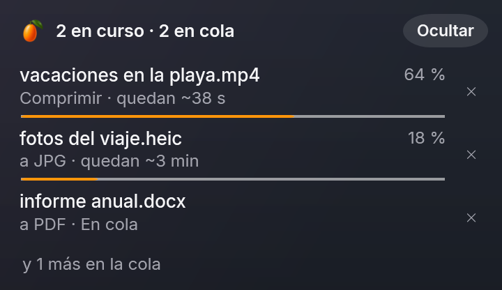
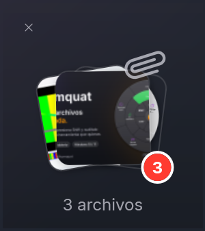
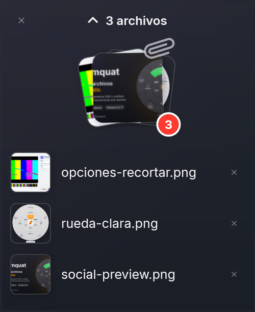

<p align="center"></p>

<h1 align="center">Kumquat</h1>

<p align="center"><b>Español</b> · <a href="README.en.md">English</a></p>

<p align="center">
  <a href="https://github.com/MartinQuiri/kumquat/actions/workflows/ci.yml"></a>
  <a href="https://github.com/MartinQuiri/kumquat/releases"></a>
  <a href="LICENSE"></a>
  
  
  
</p>

**Convierte archivos sin abrir nada.** Arrastra un archivo, presiona **Shift** y suéltalo sobre el formato que quieras en la rueda que aparece junto al cursor. Todo ocurre en tu PC: nada se sube a internet.

Kumquat es una alternativa libre (GPL-3.0) para Windows inspirada en la interacción de [Tangerine para Mac](https://tangerineformac.com). No está afiliado a Tangerine ni a Leap Studio. Los mismos motores y conversiones están también en **Linux y macOS** como herramienta de línea de comandos ([`kumquat-cli`](#linux-y-macos-cli)).

> **Estado: pre-alfa (0.2).** Ver [hoja de ruta](#hoja-de-ruta).

<p align="center"></p>

## Instalar

1. Descarga **`Kumquat-<versión>-win-x64.msi`** desde [Releases](https://github.com/MartinQuiri/kumquat/releases) (o `win-arm64` para equipos ARM).
2. Ábrelo: se instala solo para tu usuario, **sin pedir permisos de administrador**, y Kumquat se abre al terminar.

¿Prefieres no instalar nada? El `.zip` es portable: descomprímelo y abre `Kumquat.exe`.

> Mientras los releases no estén firmados, Windows SmartScreen puede avisar "Windows protegió su PC": **Más información → Ejecutar de todas formas**. Cada archivo publica su SHA-256 para que puedas verificarlo.

### Linux y macOS (CLI)

La rueda, las ventanas y la bandeja son de Windows; en Linux y macOS está `kumquat-cli`, con las mismas conversiones y herramientas.

**Linux** (x64 o ARM64; Ubuntu 22.04, Debian 12, Fedora 35, RHEL 9 o más nuevos —glibc 2.34+—): descarga `Kumquat-<versión>-linux-x64.tar.gz` (o `linux-arm64`) desde [Releases](https://github.com/MartinQuiri/kumquat/releases). Trae FFmpeg, qpdf y MuPDF; el OCR usa el Tesseract de tu distribución.

```sh
tar -xzf Kumquat-0.2.0-linux-x64.tar.gz
sudo apt install tesseract-ocr tesseract-ocr-spa   # opcional, para OCR (dnf: tesseract tesseract-langpack-spa)
./kumquat-0.2.0-linux-x64/kumquat-cli engines      # qué motores encontró
```

**macOS** (Apple Silicon o Intel): descarga `Kumquat-<versión>-osx-arm64.tar.gz` (o `osx-x64`). Los motores se instalan con [Homebrew](https://brew.sh):

```sh
brew install ffmpeg qpdf mupdf-tools tesseract tesseract-lang
tar -xzf Kumquat-0.2.0-osx-arm64.tar.gz
xattr -dr com.apple.quarantine kumquat-0.2.0-osx-arm64   # el paquete todavía no está notarizado
./kumquat-0.2.0-osx-arm64/kumquat-cli engines
```

Si tienes LibreOffice o Calibre instalados, la CLI también los usa (Office → PDF, libros electrónicos). MuPDF tiene que ser 1.24 o más nuevo: el de Ubuntu 22.04 y 24.04 es más viejo, por eso el paquete de Linux trae el suyo.

## Cómo se usa

1. Ejecuta `Kumquat.exe`: aparece el kumquat en el área de notificación.
2. Empieza a arrastrar un archivo desde el Explorador (o cualquier app).
3. Sin soltar, toca **Shift**. Aparece la rueda bajo el cursor.
4. Suelta sobre un formato. La copia convertida aparece junto al original (el original nunca se toca).

**Progreso:** si algo tarda (un video, un PDF grande, un lote de fotos), abajo a la derecha aparece un panel con cada archivo, su porcentaje y **cuánto falta**, calculado con el ritmo real del trabajo. Cada fila se puede cancelar, y "Ocultar" lo esconde hasta el próximo lote. Lo instantáneo no lo hace aparecer, y al terminar se va solo.

<p align="center"></p>

Soltar en el centro (el logo) o presionar **Esc** cancela. El gesto se puede cambiar a Ctrl, Bloq Mayús o clic derecho en **Configuración** (menú del ícono).

**Accesibilidad:** todo lo de la rueda se puede hacer con el teclado desde el buscador (Ctrl+Alt+K o clic derecho → Kumquat…). Con Narrador, NVDA o JAWS, la rueda anuncia qué se arrastró, cuántas opciones hay y qué sector queda elegido, y el buscador dice la opción elegida y su posición. En alto contraste, la rueda y las ventanas usan solo los colores del sistema.

**Idioma:** español o inglés. Por defecto, el de Windows (si Windows está en otro idioma, inglés); se cambia en Configuración. ¿Quieres traducir Kumquat a tu idioma? Ver [CONTRIBUTING.md](CONTRIBUTING.md#textos-e-idiomas).

**Con el teclado: el buscador.** Selecciona uno o más archivos en el Explorador (o en el escritorio) y presiona **Ctrl+Alt+K**, o haz clic derecho → **Kumquat…** (en Windows 11 está en el menú nuevo; en Windows 10, en el clásico). Aparece un buscador con todo lo que se puede hacer con esos archivos: escribe para filtrar (`pdf`, `comprimir`, `achicar`, `ruta`… sin importar tildes), ↑ ↓ para elegir, **Enter** para aplicar y **Esc** para cerrar. La rueda queda para arrastrar con el mouse.

<p align="center"></p>

La entrada del clic derecho se registra solo para tu usuario, sin permisos de administrador; se quita en Configuración o con `Kumquat.exe --unregister`.

También hay una CLI (la misma en Windows, Linux y macOS):

```powershell
kumquat-cli convert foto.heic --to jpg
kumquat-cli convert *.wav --to mp3 --out D:\musica
kumquat-cli targets video.mkv      # a qué formatos se puede convertir
kumquat-cli tools informe.pdf      # herramientas disponibles (comprimir, unir, OCR…)
```

## La rueda: 3 anillos

| Anillo | Qué hace |
|---|---|
| **Interior** (naranja) | Convertir a otro formato |
| **Medio** (verde azulado) | Herramientas |
| **Exterior** (violeta) | Acciones sobre el archivo |

Cada herramienta tiene su ícono y el color de su familia (PDF rojo, imagen verde, video índigo, audio rosa). Los anillos vacíos no se muestran.

### Conversiones

| Familia | Entrada | Salida |
|---|---|---|
| Imágenes | JPG, PNG, WebP, GIF, HEIC, AVIF, TIFF, BMP, SVG | JPG, PNG, WebP, GIF, AVIF, TIFF, BMP, PDF |
| Audio | MP3, M4A, WAV, FLAC, OGG, Opus, AIFF, WMA | las mismas |
| Video | MP4, MOV, MKV, WebM, AVI, WMV, GIF | las mismas + extraer audio + GIF |
| PDF / EPUB | PDF, EPUB | TXT; EPUB → PDF; **PDF → Word (DOCX)** |
| Office | DOCX, DOC, ODT, RTF · XLSX, XLS, ODS · PPTX, PPT, ODP | PDF |
| Libros (con Calibre) | EPUB, MOBI, AZW3, FB2, DOCX | EPUB, AZW3 (Kindle), MOBI, PDF |

Las conversiones de varios pasos se planifican solas (p. ej. HEIC → JPG → PDF), y nunca se ofrecen destinos sin sentido (una foto no se convierte a MP3).

### Herramientas

| Para | Herramientas |
|---|---|
| Imágenes | Comprimir · Rotar 90° · Voltear · Máx. 1920 px · Blanco y negro · **Metadatos** · Sin metadatos · Extraer texto (OCR) · PDF buscable (OCR) · Unir en PDF (varias) |
| PDF | Comprimir · Rotar 90° · Dividir páginas · Páginas a JPG · **Extraer páginas** · **Proteger** · **Desbloquear** · **Metadatos** · Reconocer texto (OCR) · Unir PDF (varios) |
| Video | Comprimir · Quitar audio · Rotar 90° · Fotograma · **Recortar** · **Metadatos** · Unir videos (varios) |
| Audio | Normalizar · **Recortar** · **Metadatos** · Unir audios (varios) |
| Word, Excel, PowerPoint | **Metadatos** |
| Comprimidos | Extraer (ZIP, RAR, 7z, TAR, GZIP) |
| Todo, incluidas carpetas | Crear ZIP |

**PDF con contraseña:** no hace falta desbloquearlo antes. Comprimir, Rotar, Dividir, Extraer páginas y Páginas a JPG piden la contraseña y lo abren solos; el resultado queda protegido con la misma (las imágenes, sin contraseña). Con Proteger se cambia: pide la actual y la nueva. El original nunca se toca.

Las herramientas en **negrita** abren una ventana de opciones (vidrio acrílico de Windows 11) con los valores actuales del archivo ya cargados y **vista previa**:

- **PDF:** miniaturas de las páginas; en *Extraer páginas* se eligen con un clic (sincronizado con el campo de texto).
- **Video:** reproductor y tira de fotogramas con asas para elegir el tramo a recortar; al mover un asa se ve ese fotograma.
- **Audio:** forma de onda con el tramo elegido y reproducción.
- **Fotos:** la imagen.

<p align="center"></p>
<p align="center"></p>

**Metadatos:** autor, título, asunto, palabras clave, etc., con campos personalizados en PDF, audio y video. Al editar varios archivos a la vez solo se cambian los campos que modificas. En fotos el autor se escribe en XMP y en los campos de Windows (Unicode: "María Pérez" se ve bien en el Explorador), y en JPEG la imagen no se recomprime: los píxeles quedan idénticos.

Al unir, el orden es el natural de los nombres (`foto2` antes que `foto10`). El resultado aparece junto al original (`foto (comprimido).jpg`); nunca se sobrescribe nada.

### Reconocer texto (OCR)

Con [Tesseract](https://github.com/tesseract-ocr/tesseract), en español e inglés a la vez y sin salir de tu PC:

- **Extraer texto:** una foto o captura → `.txt`.
- **PDF buscable:** una foto → PDF con la imagen y el texto encima, invisible: se puede seleccionar, copiar y buscar.
- **Reconocer texto:** un PDF escaneado → PDF buscable. Solo se reconocen las páginas que no tienen texto; las que ya lo tienen quedan exactamente como estaban.

### Documentos de Office

Kumquat convierte con **lo que ya tienes instalado**: si hay Microsoft Office usa Word, Excel y PowerPoint (la mejor fidelidad con sus propios formatos); si no, [LibreOffice](https://www.libreoffice.org). Ninguno de los dos viene con Kumquat. Si no hay ninguno, la rueda ofrece **Instalar LibreOffice**: pide permiso, lo instala con winget desde el paquete oficial y Kumquat se reinicia solo.

- Office se abre invisible, con las macros desactivadas y en solo lectura, sobre una copia del archivo; una conversión a la vez.
- Un documento con contraseña falla con un aviso en vez de pedirla.
- Si Office no responde en 5 minutos se cierra solo la ventana de Office que abrió Kumquat, nunca una tuya.

### Libros electrónicos

EPUB → PDF y EPUB → TXT funcionan siempre (MuPDF viene con Kumquat). Para Kindle (MOBI, AZW3), FB2 y Word → EPUB, Kumquat usa [Calibre](https://calibre-ebook.com) si está instalado; si no, la rueda ofrece **Instalar Calibre** igual que con LibreOffice. Calibre corre con una configuración temporal: no toca tu biblioteca ni tus preferencias. Los libros con DRM no se pueden convertir.

### Adjuntos, archivos de un .zip e imágenes de una web

Se pueden soltar en la rueda **sin guardarlos antes**: un adjunto arrastrado desde Outlook, un archivo de dentro de un .zip abierto en el Explorador o una imagen de una página web. Como no tienen carpeta propia, el resultado va al **Escritorio** (se cambia en Configuración) y la etiqueta bajo la rueda lo avisa. En el anillo de acciones aparece **Guardar en Escritorio** para simplemente guardarlos.

### Acciones

Copiar ruta · **Flotar** · Copiar a… · Mover a… · Ver en carpeta · Terminal aquí (y Guardar en… para archivos sin carpeta)

### Flotar: una bandeja para llevar archivos de un lado a otro

<p align="center"> &nbsp; </p>

Suelta archivos en **Flotar** y quedan en una pila flotante, siempre a la vista, mientras navegas a otra carpeta o abres la página donde tienes que subirlos. Arrastra la pila para soltarlos todos juntos (en una carpeta, un correo o un formulario web) o haz clic para verlos uno por uno y arrastrar solo el que necesites. Puedes seguir soltándole archivos encima, tener varias bandejas a la vez y moverlas arrastrando su borde. Nada se copia ni se mueve al dejarlos ahí; lo que mueves a otra carpeta sale de la bandeja, y vacía se cierra sola.

## Compilar

Requisitos: Windows 10 22H2+ o 11, [.NET SDK 10](https://dotnet.microsoft.com/download) (la versión exacta está en `global.json`) y, para compilar Tesseract la primera vez, Visual Studio 2022 con "Desarrollo para el escritorio con C++" (trae vcpkg).

```powershell
./tools/fetch-engines.ps1          # descarga los motores verificando su SHA-256 y compila Tesseract
dotnet build Kumquat.slnx
dotnet test --solution Kumquat.slnx --filter-not-trait "Category=E2E" --ignore-exit-code 8
dotnet run --project src/Kumquat.App
```

Para generar el paquete distribuible (self-contained, recortado, ~230 MB en zip —casi la mitad son los modelos de OCR—, arranque ~0,3 s) y su instalador:

```powershell
./tools/publish.ps1 -Runtime win-x64           # o win-arm64
./tools/build-installer.ps1 -Runtime win-x64   # MSI por usuario, sin administrador
```

Cómo se publica una versión (firma, winget): [docs/RELEASING.md](docs/RELEASING.md).

**En Linux o macOS** se compila y prueba todo lo que no es interfaz (núcleo, motores, CLI) con `Kumquat.Unix.slnf`. Hace falta [PowerShell 7](https://learn.microsoft.com/powershell/scripting/install/installing-powershell) para los scripts; en Linux, además, `make` (MuPDF se compila la primera vez, en unos minutos, con un zig fijado que el script descarga) y, para el OCR, Tesseract con español e inglés. En macOS, los motores de Homebrew (ver arriba).

```sh
pwsh ./tools/fetch-engines.ps1                       # Linux: FFmpeg y qpdf (SHA-256 verificado) y compila MuPDF
dotnet test --solution Kumquat.Unix.slnf
dotnet run --project src/Kumquat.Cli -- engines
pwsh ./tools/publish-unix.ps1 -Runtime linux-x64     # .tar.gz distribuible (linux-arm64, osx-arm64, osx-x64)
```

Los tests E2E hacen un arrastre real moviendo el mouse: córrelos solo cuando no estés usando el PC (`dotnet test --project tests/Kumquat.E2E.Tests`).

## Calidad

- Toda advertencia del compilador y de los analizadores (.NET, Meziantou, reglas propias) es un error.
- APIs peligrosas prohibidas en compilación: lanzar procesos con argumentos concatenados, extraer ZIP sin validar rutas, etc. ([BannedSymbols.txt](BannedSymbols.txt)).
- **Un test de integración por cada conversión directa**, generado desde el grafo de capacidades: si alguien agrega una conversión, queda probada automáticamente. Las salidas se verifican por contenido (bytes mágicos) y con ffprobe (duración, dimensiones, pistas).
- Office y Calibre se prueban con los programas reales cuando están (Office genera sus propias muestras); para probar Calibre sin instalarlo, `KUMQUAT_TEST_CALIBRE` apunta al `ebook-convert.exe` de una copia extraída del MSI.
- Tests basados en propiedades (CsCheck) para el planificador, la detección de formatos y la geometría de la rueda.
- Los motores corren como procesos aparte dentro de un *Job Object* de Windows (memoria acotada, mueren con Kumquat), con prioridad baja. En Linux, memoria acotada con `prlimit`; en Linux y macOS, al cancelar se termina el árbol de procesos completo.
- CI en Windows (x64 y ARM64), Linux (x64 y ARM64) y macOS, CodeQL, OpenSSF Scorecard, REUSE y Dependabot.

Detalles en [docs/ARCHITECTURE.md](docs/ARCHITECTURE.md) y [CONTRIBUTING.md](CONTRIBUTING.md).

## Hoja de ruta

- [x] Fase 0–1: rueda de conversión, imágenes/audio/video, bandeja, CLI.
- [x] Fase 2a: rueda de 3 anillos, herramientas de PDF, imagen, audio, video y comprimidos; acciones copiar/mover.
- [x] Fase 2b: ventana de opciones (Fluent), recortar audio/video, extraer páginas, proteger/desbloquear PDF, metadatos de fotos, PDF, audio, video y Office.
- [x] Rediseño: rueda de vidrio con íconos, tipografía Inter, ventanas acrílicas con vista previa de PDF, fotos, audio y video.
- [x] Atajo Ctrl+Alt+K sobre la selección del Explorador (pestañas de Windows 11 y escritorio incluidos).
- [x] Menú del clic derecho del Explorador (menú clásico; el nuevo de Windows 11 llega con el instalador firmado).
- [x] OCR con Tesseract (compilado por Kumquat): imagen → texto, imagen → PDF buscable, PDF escaneado → PDF buscable.
- [x] Office → PDF y PDF → Word con Microsoft Office o LibreOffice (el que esté instalado; si no hay, se ofrece instalar LibreOffice).
- [x] Libros electrónicos con Calibre: EPUB, MOBI, AZW3, FB2 y Word → EPUB/AZW3/MOBI/PDF.
- [x] Interfaz en español e inglés (traducible: un `.resx` por idioma).
- [x] Instalador MSI por usuario (sin administrador) y manifiesto de winget ([docs/RELEASING.md](docs/RELEASING.md)).
- [x] "Kumquat…" en el menú moderno de Windows 11 (se activa con los releases firmados; en desarrollo, con el Modo de desarrollador).
- [x] `kumquat-cli` en Linux (x64, ARM64) y macOS, con los mismos motores (FFmpeg, qpdf y MuPDF fijados en Linux).
- [ ] Firma de código (SignPath), envío a winget y Microsoft Store.
- [ ] Interfaz en Linux y macOS (la rueda depende de hooks globales que Wayland no permite: hace falta otra forma de abrirla).
- [ ] Fase 4: sandbox de motores (baja integridad / AppContainer), fuzzing continuo.

## Licencia

[GPL-3.0-or-later](LICENSE). Tipografía [Inter](https://rsms.me/inter/) (OFL-1.1) e íconos [Phosphor](https://phosphoricons.com) (MIT). Kumquat incluye o descarga componentes de terceros con sus propias licencias: ver [THIRD-PARTY-NOTICES.md](THIRD-PARTY-NOTICES.md).

**Patentes:** los códecs H.264, HEVC y AAC pueden estar sujetos a patentes en algunos países. Kumquat se distribuye como software libre sin licencias de patentes; revisa la situación en tu jurisdicción si lo redistribuyes comercialmente.
